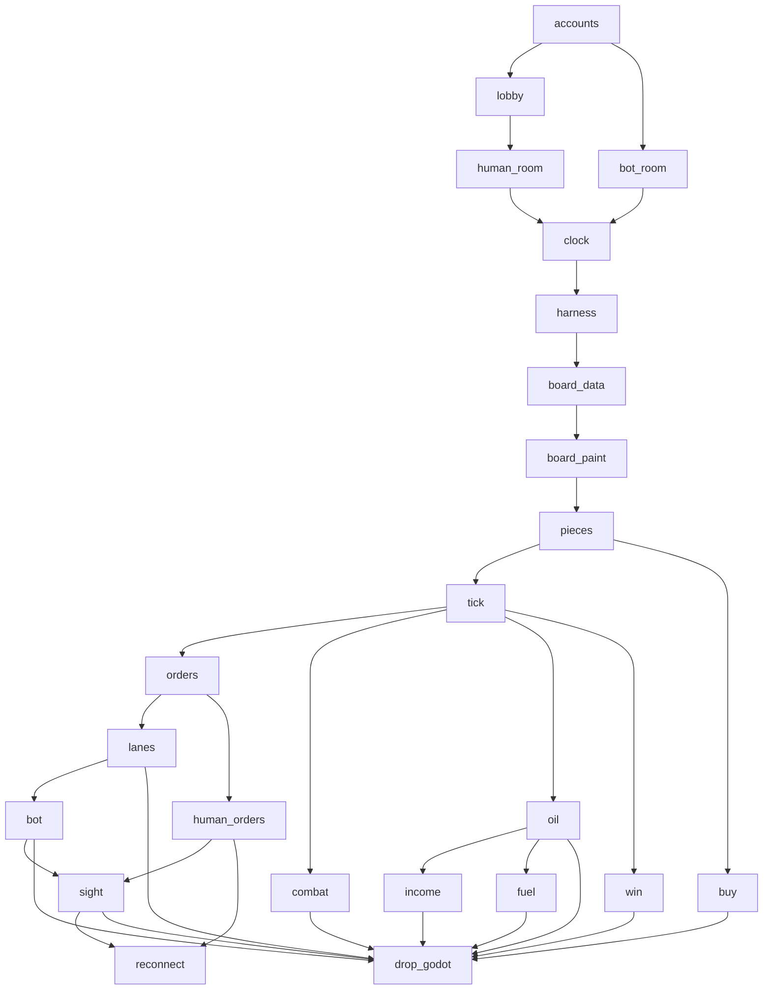

# OPENCHQ_WEB_LOOP

You cannot see the parent chat. This is one fire of a loop. The game is a web browser game. Godot is the archive on branch `desktop-godot`. Do not start Godot, embed Godot, or export Godot.

## Where we are

Checked 2026-11-06 on branch `web`. The loop is paused between fires. It is not stuck on a red test. The handoff for a new agent is `docs/WEB_HANDOFF.md`.

A fire does one ready node, requires `node web/test/run.mjs` to print `WEB_OK`, marks that node done, and stops. The fire prompt forbids commit, push, and creating a scheduler. After `harness` finished, nothing pasted the next fire, so `board_data` never started. The loop docs and `web/test/` stayed untracked until this checkpoint was committed by hand.

Iteration on this machine is 1/40, in `/tmp/openchq-web-iteration`. That file is not in git.

Done: `accounts`, `lobby`, `bot_room`, `human_room`, `clock`, `harness`. Proof: `node web/test/run.mjs` printed `WEB_OK` and exited 0. The server under test used a temporary `OPENCHQ_WEB_DATA` and a free port. It did not use port 8787 or `~/.local/share/openchq`.

Next ready node: `board_data` (order 70). Seventeen nodes after that are still `todo`, through `drop_godot`. The graph file is the authority if this paragraph and the file disagree.

What runs today: register, login, presence, a bot room, an invite, hold, and run. The clock flag changes. Pieces do not move. The page does not draw terrain cells yet.

## Graph

The work is the directed graph in `docs/web-loop.graph.json`. A node may start when every id in `depends` has `"status": "done"`. Among those ready nodes, do the one with the smallest `order`. Do that one node. Prove it. Stop. Do not start the next node in the same fire.



`accounts`, `lobby`, `bot_room`, `human_room`, `clock`, and `harness` are done. The next fire starts at `board_data`.

## Where to work

Work only in `/mnt/nas/projects/OpenCHQ` on branch `web`. Do not commit or push. Do not switch to `main` or `desktop-godot`. Do not build in `/mnt/nas/projects/Command HQ/modern/game/`.

Read behavior from `docs/WEB_PLAN.md` and, as reference only, from `scripts/match_state.gd` and `scripts/terrain_map.gd`. Implement the behavior in `web/`. Do not copy guessed formulas from `docs/re/ECONOMY.md` or `docs/re/COMBAT.md`. Do not copy ratings from `resources_oil.json`. Do not put the unpacked executable, `WORLD_MAP.png`, or the unit stills in a browser response.

The live server port is 8094. Port 8787 belongs to another program. Tests bind `127.0.0.1` on a free port and set `OPENCHQ_WEB_DATA` to a temporary directory. Do not point tests at `~/.local/share/openchq`.

## Each fire

Create `/tmp/openchq-web-iteration` if it is missing, with contents `0`. Read it, add 1, and write the new number back. If that number is greater than 40, report `CAP 40 reached` and stop. Do not touch `/tmp/openchq-polish-iteration`.

If the chosen node is already satisfied in the tree, set its `status` to `done` in `docs/web-loop.graph.json`, name the evidence, and stop. That counts as the fire. Do not implement a second node.

Implement only the chosen node. Extend `web/test/run.mjs` in that same fire so the new proof runs with every earlier proof. A comment is not a proof.

Then run:

```
node web/test/run.mjs
```

The run must print `WEB_OK` and exit 0. Tests call the match tick function directly. They do not sleep 0.14 seconds per round.

If `WEB_OK` is missing, leave the node `todo`, report the failing line, and stop. Do not start another node.

If `WEB_OK` printed, set that node's `status` to `done` and stop.

When every node is `done`, report the closing block and stop.

If a scheduler task exists whose prompt contains `OPENCHQ_WEB_LOOP` and this fire hit the cap, a red test, or a finished graph, delete that task and stop. If no such task exists, do not create one.

## Report

After a finished node, one line: iteration N/40, the node id, `WEB_OK`, and the next ready node id.

The closing block lists nodes done, nodes still todo, files changed, and `WEB_OK` or the failing line.

## Rules the nodes must keep

- Two sides only. Blue and Red. Washington and Moscow. Holding both capitals wins.
- The server owns the clock and the pieces. The page sends orders for its own seat.
- One running round is 0.14 seconds on the live clock. Hold stops the clock. Tests do not wait for that interval.
- A human room never runs bot orders. A bot room marches the empty army toward the player capital and sails the empty ship once.
- Sight is 8 cells, Chebyshev, X wraps. Enemy routes in a view are the first three steps. Hidden pieces are omitted.
- City income is 1 billion per city. Oil income is 1 billion per owned well. Both are added on every 25th round. Capitals are not cities.
- Each side has its own fuel reserve of 10000, burning 1 off a well. A dry side stops. The other side does not.
- A tank costs twice an infantry. A nuke is refused. Do not invent a damage number or an oil production rate.
- Player-facing match text must not contain `$`, `production`, `Command HQ`, `beats`, or `one extra`.

## Paste this as the loop fire

```
OPENCHQ_WEB_LOOP. You cannot see the parent chat. This is one fire.

The game is the browser game in /mnt/nas/projects/OpenCHQ on branch web. Read docs/WEB_LOOP.md and docs/web-loop.graph.json. Do not start Godot.

Pick the single ready graph node with the smallest order. Implement only that node. Extend web/test/run.mjs. Run node web/test/run.mjs. Require WEB_OK. Mark that node done only after WEB_OK. Stop. Do not commit. Do not push. Do not use port 8787. Do not spend the user's real account database.
```
